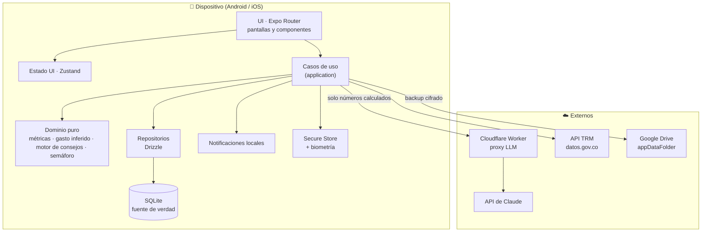
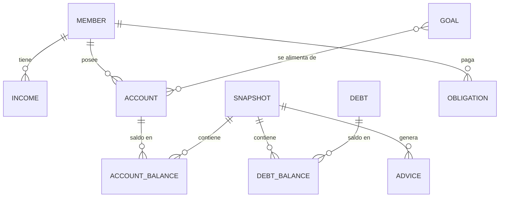
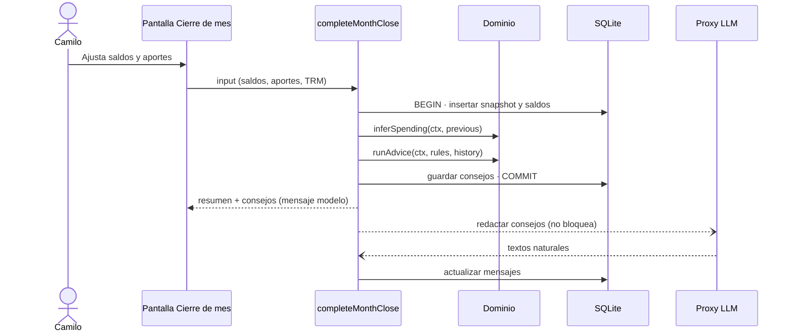

# App de Asesoría Financiera — Arquitectura v0.1

_24 nov 2026 · Complementa `diseno-funcional.md` (v0.6). Los IDs (M1–M8, C01–C09, RF-x, P1–P6) se refieren a ese documento._

---

## 1. Decisiones clave

| # | Decisión | Alternativas descartadas | Por qué |
|---|---|---|---|
| A1 | **React Native + Expo (TypeScript)**, Android primero | Flutter, Kotlin nativo | Un solo código para Android e iOS; TypeScript ya es conocido (Playwright) |
| A2 | **Local-first:** SQLite en el dispositivo como única fuente de verdad | Backend con base de datos en la nube | Privacidad (P6), cero costo, funciona sin internet |
| A3 | **Dominio puro en TypeScript** (fórmulas, motor de consejos, semáforo) sin dependencias de React ni de la base de datos | Lógica dentro de los componentes | Se prueba al 100% con tests unitarios; números deterministas (P3) |
| A4 | **Proxy serverless mínimo para el LLM** (Cloudflare Worker) | Llamar la API del LLM desde la app | La llave de la API no puede ir en el APK; el proxy solo recibe números ya calculados |
| A5 | **Dinero como enteros** (COP en pesos, USD en centavos) | `number` con decimales | Evita errores de punto flotante en sumas y comparaciones |
| A6 | **Backup cifrado en Google Drive** (carpeta privada de la app) | Sin backup, o servidor propio | Recuperar datos si se pierde o cambia el celular, sin servidor |

---

## 2. Stack

| Capa | Tecnología | Uso |
|---|---|---|
| App | Expo (SDK estable más reciente) + **Expo Router** | Navegación basada en archivos |
| UI | React Native + StyleSheet con tema propio | Pantallas del lienzo de diseño (`pantallas.md`) |
| Estado de UI | **Zustand** | Estado efímero (formularios, borradores del cierre de mes) |
| Persistencia | **expo-sqlite** + **Drizzle ORM** | Esquema tipado y migraciones |
| Dominio | TypeScript puro (`src/domain`) | Métricas, gasto inferido, reglas, semáforo |
| Notificaciones | **expo-notifications** (locales) | Recordatorio del cierre de mes |
| Seguridad local | **expo-local-authentication** + **expo-secure-store** | Bloqueo con huella o PIN; guardar el token del proxy y la clave del backup |
| Backup | Google Sign-In + Drive API (`appDataFolder`) | Exportar e importar un JSON cifrado |
| TRM | API de datos abiertos (datos.gov.co, dataset de TRM) | TRM del día, con caché y edición manual |
| LLM | Cloudflare Worker → API de Claude | Redacción de consejos y chat de "¿Lo compro?" |
| Tests unitarios | **Jest** (`jest-expo`) | Dominio y repositorios |
| Tests E2E | **Maestro** | Flujos en emulador o dispositivo Android |
| CI/CD | GitHub Actions + **EAS Build** | Lint, tests y generación del APK/AAB |

---

## 3. Vista de componentes



**Regla de dependencias:** `ui → application → domain`. `domain` no importa nada del proyecto ni de librerías externas. `application` orquesta: lee de los repositorios, llama al dominio, guarda resultados y llama a servicios externos.

---

## 4. Capas

### 4.1 `domain/` — lógica pura (el corazón)
- Funciones puras y tipos. Sin `async`, sin base de datos, sin React.
- Contiene: conversión de moneda, métricas (PN, liquidez, GTH, meses de colchón), gasto inferido (sección 4.1 del diseño), proyección de metas, motor de consejos (C01–C09), evaluación de compra (semáforo M8), reparto del hogar (M4), conversión de tasas EM↔EA.
- Recibe un **`FinancialContext`** inmutable armado por la capa `application`.

```ts
// domain/types.ts
export type Money = { amount: number; currency: 'COP' | 'USD' }; // amount entero (pesos o centavos)

export interface FinancialContext {
  asOf: string;                 // ISO date
  trm: number;                  // COP por USD
  settings: Settings;           // parámetros de la sección 5.0
  accounts: AccountBalance[];   // del snapshot actual
  previous?: SnapshotSummary;   // snapshot anterior (para deltas)
  debts: DebtBalance[];
  obligations: Obligation[];
  proratedExpenses: ProratedExpense[];
  provisions: Provision[];
  goals: Goal[];
  household: Household;
}
```

```ts
// domain/advice/rule.ts
export type Severity = 'alta' | 'media' | 'baja';

export interface AdviceResult {
  ruleId: string;               // 'C01'...'C09'
  severity: Severity;
  impactCop: number;            // para ordenar
  data: Record<string, number | string>; // valores para la plantilla y el LLM
  fallbackMessage: string;      // mensaje modelo (sin LLM)
}

export interface AdviceRule {
  id: string;
  requires: (keyof FinancialContext)[];  // si falta algo → no se dispara (RF-1.3)
  evaluate(ctx: FinancialContext): AdviceResult | null;
}
```

```ts
// domain/advice/engine.ts
export function runAdvice(ctx: FinancialContext, rules: AdviceRule[], history: AdviceHistory): AdviceResult[] {
  return rules
    .filter(r => hasRequiredData(ctx, r.requires))
    .map(r => r.evaluate(ctx))
    .filter((a): a is AdviceResult => a !== null)
    .filter(a => !isInCooldown(a, history, ctx.settings.adviceCooldownDays))
    .sort(bySeverityThenImpact)
    .slice(0, ctx.settings.maxVisibleAdvice);
}
```

#### 4.1.1 Precisiones de cálculo (fase 1)
Decisiones tomadas al implementar `src/domain`, donde el diseño funcional no era explícito:

| Tema | Regla implementada |
|---|---|
| Unidades | COP en pesos, USD en centavos, TRM en centavos de peso por USD, tasas en puntos básicos |
| Reparto automático (M4) | El % de cada miembro se redondea al entero (8,79M / 14,39M → 61%) y el último miembro recibe el resto. Así sale el caso dorado 4.367.600 / 2.792.400 |
| Gasto total del hogar | Compartidos + personales de todos. Las líneas de ahorro (vacaciones, inversiones) se registran como **metas**, no como obligaciones, así que no entran al gasto |
| Provisiones | Cuentan como gasto personal del miembro principal (provisiones / 12) |
| Liquidez disponible | Cuentas `inmediata` con "cuenta como liquidez" − tarjetas del principal − obligaciones pendientes del mes. Como aún no se registra qué obligaciones están pagadas, las pendientes llegan como dato desde `application` (0 por defecto) |
| Gasto inferido | Solo compara cuentas y deudas presentes en los dos snapshots: una cuenta recién registrada no es ahorro. Los ingresos del periodo y el presupuesto llegan desde `application` |
| Fondo de emergencia (meta) | Se marca con `isEmergencyFund`; su objetivo sale de los ajustes y su avance es la liquidez disponible. **Falta la columna en el esquema** (fase 2) |
| C05 | Meses transcurridos = 12 − meses completos hasta la fecha de pago |
| C06 | "Sin rendimiento" = cuenta `inmediata` no marcada como inversión |
| M8 · provisión cercana | Solo considera provisiones con fecha en la ventana y apartado < monto anual. "Obligación grande" no está definida y no se evalúa |
| M8 · retraso de meta | Si la meta prioritaria no tiene aporte mensual, no hay retraso (pregunta abierta del diseño funcional) |

### 4.2 `application/` — casos de uso
Cada caso de uso es una función `async` que coordina repositorios, dominio y servicios:

| Caso de uso | Qué hace |
|---|---|
| `getMonthCloseDraft()` | Saldos del snapshot anterior + TRM del día para precargar el cierre de mes |
| `completeMonthClose(input)` | Guarda el snapshot (saldos, aportes, TRM) en una transacción → calcula el gasto inferido → corre el motor de consejos → persiste los consejos → reprograma la notificación |
| `evaluatePurchase(input)` | Arma el `FinancialContext` → `domain.evaluatePurchase` → (opcional) pide la redacción al proxy |
| `getDashboard()` | Lee el último snapshot y los consejos activos → métricas para Inicio |
| `getGoals()` | Metas en orden de prioridad con avance, proyección y estado (M6) |
| `getHouseholdSplit(month)` | Reparto y balance (M4) |
| `getSettings()` / `updateSetting(key, value)` | Leer y guardar al instante los parámetros de la sección 5.0 |
| `dismissAdvice(id)` | Marca el consejo como descartado (enfriamiento) |
| `exportBackup()` / `importBackup()` | Serializa la base → cifra → Drive, y el camino inverso |
| `refreshTrm()` | Trae la TRM del día, guarda caché y deja editar a mano |

### 4.3 `data/` — persistencia
- Drizzle sobre expo-sqlite. **Migraciones versionadas** desde el día 1 (el esquema va a cambiar).
- Repositorios por agregado: `accounts`, `snapshots`, `debts`, `obligations`, `goals`, `advice`, `settings`, `household`.
- Los snapshots **no se editan después de guardarse**; si hay un error se corrige con un nuevo cierre o con una edición auditada (`edited_at`).

### 4.4 `services/` — integraciones externas
- `llmClient`: llama al proxy con timeout de 8 s; si falla, la UI usa `fallbackMessage`.
- `trmClient`: TRM del día con caché de 24 h.
- `driveBackup`: Google Sign-In con permiso solo para `drive.appdata`.
- `notifications`: programa el recordatorio del día N y el reintento.

### 4.5 `ui/` — pantallas
Las rutas siguen el lienzo de diseño. Los componentes no calculan nada: reciben datos ya listos de los casos de uso.

---

## 5. Modelo de datos (SQLite)



| Tabla | Campos principales |
|---|---|
| `member` | id, name, income_profile (`empleado`/`contratista`/`independiente`), is_primary |
| `income` | id, member_id, concept?, amount, currency, kind (`fijo`/`variable`), frequency |
| `account` | id, name, institution, currency, liquidity (`inmediata`/`con_fecha`/`volatil`), owner_member_id \| null (compartida), is_investment, maturity_date?, counts_as_liquidity (bool), sort_order, archived |
| `snapshot` | id, date, trm_cents (TRM en centavos de peso), created_at, edited_at?, note? |
| `account_balance` | snapshot_id, account_id, balance, contribution? (aporte del periodo) |
| `debt` | id, name, kind (`tarjeta_credito`/`hipoteca`/`credito_consumo`/`informal`), direction (`debo`/`me_deben`), currency, rate_bps? (tasa en puntos básicos: 2,10% → 210), rate_unit (`EM`/`EA`)?, installment?, term_months?, owner_member_id?, archived |
| `debt_balance` | snapshot_id, debt_id, balance |
| `obligation` | id, concept, amount, currency, frequency, payer_member_id, payment_method?, shared (bool), archived |
| `prorated_expense` | id, concept, cost, duration_months, owner_member_id, start_date?, archived |
| `provision` | id, concept, annual_amount, due_date, saved_amount, archived |
| `goal` | id, name, kind (`acumular`/`aporte_recurrente`), target_amount?, target_date?, monthly_contribution?, priority, manual_progress?, archived |
| `goal_account` | goal_id, account_id |
| `advice` | id, rule_id, snapshot_id?, severity, impact_cop, data_json, message, status (`nuevo`/`visto`/`descartado`/`resuelto`), created_at, dismissed_at? |
| `purchase_query` | id, description?, price, currency, payment_method (`contado` o id de la deuda), installments?, kind (`necesidad`/`gusto`), result_json, created_at |
| `setting` | key, value_json (parámetros de la sección 5.0) |

---

## 6. Flujos principales

### 6.1 Cierre de mes


### 6.2 ¿Lo compro?
1. La UI envía `{precio, moneda, medio, cuotas, tipo}`.
2. `evaluatePurchase` arma el contexto y llama a `domain.evaluatePurchase`, que devuelve el semáforo, las razones y la alternativa.
3. La UI muestra el resultado **de inmediato** con los textos modelo. Si el usuario abre "Preguntar algo", se llama al proxy con el resultado ya calculado.

---

## 7. Proxy del LLM (Cloudflare Worker)

**Responsabilidad única:** recibir datos ya calculados, armar el prompt y devolver texto. No guarda nada.

```
POST /v1/advice-text
Headers: Authorization: Bearer <token de instalación>
Body: {
  "kind": "advice" | "purchase" | "chat",
  "items": [{ "ruleId": "C01", "data": { "months": 1.5, "min": 4, "missingCop": 24400000 } }],
  "question"?: "string (solo en chat)",
  "locale": "es-CO"
}
→ 200 { "texts": ["..."] }
```

- **Nunca se envían** nombres de cuentas, entidades ni saldos completos; solo los valores que la regla necesita.
- El prompt del sistema fija el tono (directo, en español de Colombia, sin recomendar productos de inversión específicos) y prohíbe que el modelo haga cálculos nuevos: solo redacta con los números que recibe.
- **Seguridad:** la llave de la API vive como secreto del Worker. La app usa un token por instalación guardado en Secure Store. Límite de solicitudes por token.
- **Modelo:** uno rápido y económico (por ejemplo, Claude Haiku) basta para redactar.
- **Costo:** para una persona, unas decenas de llamadas al mes; prácticamente gratis en el plan gratuito de Workers más el uso de la API.

---

## 8. Seguridad y privacidad

| Riesgo | Mitigación v1 | v2 |
|---|---|---|
| Alguien toma el celular | Bloqueo con huella o PIN al abrir (`expo-local-authentication`) | — |
| Fuga de la llave del LLM | La llave solo vive en el Worker | Rotación automática |
| Datos en el backup | JSON cifrado (AES-GCM) con una clave derivada de una frase del usuario, guardada en Secure Store | — |
| Base de datos local sin cifrar | Se acepta en v1 (el bloqueo del sistema operativo más el de la app) | Cifrar la base con SQLCipher (`op-sqlite`) |
| Datos enviados al LLM | Solo números agregados; sin nombres de cuentas ni saldos completos | — |

---

## 9. Estructura del repositorio

```
app-financiera/
├─ src/
│  ├─ app/                      # Expo Router (rutas = pantallas; convención de Expo SDK 58)
│  │  ├─ (tabs)/
│  │  │  ├─ index.tsx           # Inicio
│  │  │  ├─ metas.tsx
│  │  │  ├─ hogar.tsx
│  │  │  └─ ajustes.tsx
│  │  ├─ cierre/
│  │  │  ├─ index.tsx           # Cierre de mes (paso 1)
│  │  │  └─ resumen.tsx         # Resumen del cierre (paso 2)
│  │  ├─ lo-compro.tsx
│  │  ├─ onboarding/            # M1 asistente
│  │  └─ _layout.tsx
│  ├─ domain/
│  │  ├─ money.ts               # Money, conversión TRM, formato
│  │  ├─ rates.ts               # EM ↔ EA, cuota, intereses
│  │  ├─ metrics.ts             # PN, liquidez, GTH, colchón
│  │  ├─ spending.ts            # gasto inferido
│  │  ├─ goals.ts               # avance y proyección
│  │  ├─ household.ts           # reparto y balance
│  │  ├─ purchase.ts            # semáforo M8
│  │  ├─ advice/
│  │  │  ├─ engine.ts
│  │  │  └─ rules/              # c01-emergency-fund.ts … c09-informal-debt.ts
│  │  └─ types.ts
│  ├─ application/              # casos de uso
│  ├─ data/
│  │  ├─ schema.ts              # Drizzle
│  │  ├─ migrations/
│  │  └─ repositories/
│  ├─ services/                 # llmClient, trmClient, driveBackup, notifications
│  ├─ ui/                       # componentes reutilizables y tema
│  └─ state/                    # stores de Zustand
├─ proxy/                       # Cloudflare Worker (wrangler)
│  ├─ src/index.ts
│  └─ wrangler.toml
├─ tests/
│  ├─ fixtures/anexo-a.ts       # datos de prueba del diseño funcional
│  └─ domain/                   # tests parametrizados por regla
├─ e2e/                         # flujos Maestro (.yaml)
├─ docs/
│  ├─ diseno-funcional.md
│  └─ arquitectura.md
├─ app.json · eas.json · drizzle.config.ts · babel.config.js · metro.config.js · tsconfig.json
└─ .github/workflows/ci.yml
```

---

## 10. Estrategia de pruebas

| Nivel | Herramienta | Cobertura objetivo | Qué cubre |
|---|---|---|---|
| Unitarias del dominio | Jest | ~100% de `src/domain` | Todas las fórmulas, reglas C01–C09, semáforo, reparto, conversiones. Tests parametrizados (`test.each`) con los casos del Anexo A |
| Integración de datos | Jest + SQLite en memoria | Repositorios y migraciones | Guardar y leer un snapshot, migrar de la versión N a N+1 |
| Casos de uso | Jest con repositorios y servicios simulados | Orquestación | Un cierre de mes completo, el respaldo cuando el LLM falla |
| E2E | Maestro (Android) | Flujos críticos | Onboarding mínimo, cierre de mes, ¿Lo compro?, descartar un consejo |
| Proxy | Vitest + Miniflare | Contrato del endpoint | Auth, límite de solicitudes, formato de respuesta |

**Casos dorados (de los anexos):** reparto 61/39 → 4.367.600 / 2.792.400 · 2.200.000 en TC Rappi a 12 cuotas → intereses ≈ 311.730 · 2,1% EM → 28,32% EA · meta Japón con 500 mil/mes → C08 se dispara.

> Maestro es lo más cercano a Playwright para apps móviles nativas: los flujos se escriben en YAML. Playwright sirve para probar el build web de Expo si algún día existe.

---

## 11. CI/CD

1. **En cada PR:** `tsc --noEmit` → ESLint → Jest (dominio + datos) → tests del proxy.
2. **En `main`:** EAS Build con perfil `preview` → APK instalable en tu Android.
3. **Releases:** EAS Build con perfil `production` (AAB) cuando se quiera publicar en Play Store.
4. **E2E con Maestro:** manual al principio (en local); más adelante en Maestro Cloud o un emulador en CI.

---

## 12. Plan de implementación sugerido

| Fase | Entregable | Notas |
|---|---|---|
| **0. Base** | Repo, Expo + Router, Drizzle + primera migración, CI, tema visual | Sin pantallas reales |
| **1. Dominio** | `src/domain` completo con tests (todo el Anexo A en verde) | Se construye sin UI: es lo más valioso y lo más fácil de probar |
| **2. Datos + onboarding** | Repositorios, M1 (asistente), M2 (cuentas), M3 (deudas, obligaciones) | Ya puedes meter tus datos reales |
| **3. Cierre de mes** | M5 + Resumen + notificaciones + TRM | Primer uso real el día 8 |
| **4. Consejos e Inicio** | M7 con textos modelo + pantalla Inicio + Metas (M6) | Todavía sin LLM |
| **5. Hogar** | M4 reparto y balance | |
| **6. ¿Lo compro?** | M8 con semáforo determinista | |
| **7. LLM** | Proxy + redacción natural + chat de compra | Opcional para que la app sea útil |
| **8. Endurecimiento** | Bloqueo biométrico, backup cifrado a Drive, E2E con Maestro | Antes de dejar el Excel |

---

## 13. Riesgos y decisiones abiertas

- **Pérdida de datos:** al ser local-first, el backup (fase 8) es crítico. Mientras no exista, exportar un JSON manual desde Ajustes.
- **Migraciones del esquema:** probar cada migración con datos reales anonimizados antes de instalar una versión nueva.
- **API de la TRM:** verificar el endpoint y su disponibilidad; si falla, la TRM queda manual.
- **Costo y latencia del LLM:** la app nunca espera al LLM para mostrar números; si el proxy no responde, se usan los mensajes modelo.
- **Decidida:** StyleSheet puro con un tema propio (`src/ui/theme.ts`, ver `pantallas.md` §1.1), sin NativeWind.
