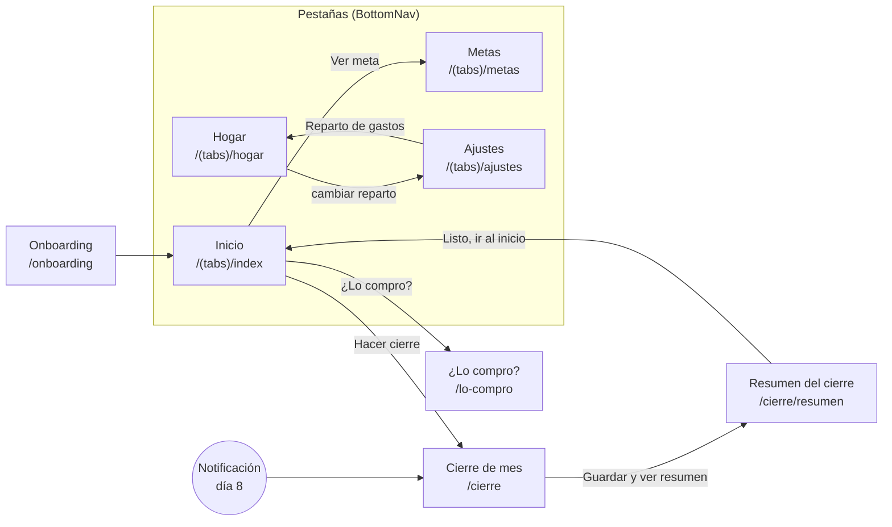

# App de Asesoría Financiera — Especificación de pantallas v0.1

_25 nov 2026 · Fuente: lienzo de diseño "App financiera — Pantallas MVP". Complementa `diseno-funcional.md` (v0.6) y `arquitectura.md` (v0.1). Los IDs (M1–M8, C01–C09, RF-x) son los del diseño funcional._

> Los números de los ejemplos vienen del Anexo A del diseño funcional. En la app real todo sale de los casos de uso; ningún valor va fijo en el código.

---

## 1. Sistema visual

### 1.1 Tokens

```ts
// src/ui/theme.ts
export const colors = {
  bg: '#F6F7F9',          // fondo de pantalla
  surface: '#FFFFFF',     // tarjetas
  border: '#E5E7EB',
  divider: '#F1F2F4',
  inputBorder: '#D1D5DB',
  text: '#111827',        // texto principal
  textBody: '#374151',    // párrafos
  textMuted: '#4B5563',   // etiquetas y secundarios (pasa 4.5:1 sobre blanco y sobre bg)
  accent: '#1D4ED8',      // acción primaria, links, selección
  accentPressed: '#1E40AF',
  secondarySplit: '#93A4C8', // segunda parte de la barra de reparto

  // semánticos (texto / fondo / borde)
  danger:  { fg: '#B42318', bg: '#FEF3F2', border: '#FECDCA' },
  warning: { fg: '#B54708', bg: '#FFFAEB', border: '#FEDF89' },
  success: { fg: '#067647', bg: '#ECFDF3', border: '#ABEFC6' },
  neutral: { fg: '#4B5563', bg: '#F1F2F4' },
};

export const radius = { sm: 8, md: 10, lg: 12, card: 14, hero: 16, pill: 999 };
export const space  = { xs: 4, sm: 8, md: 12, lg: 16, xl: 20, xxl: 24 };
export const touch  = { min: 44, primaryButton: 52, navItem: 48 };
```

### 1.2 Tipografía
- Fuente: **Inter** (400, 500, 600, 700) vía `@expo-google-fonts/inter`.
- Todos los números con **cifras tabulares** (`fontVariant: ['tabular-nums']`) para que los montos queden alineados.

| Estilo | Tamaño / peso | Uso |
|---|---|---|
| `display` | 34 / 700, letterSpacing −0,5 | Monto principal (patrimonio, gasto del mes) |
| `title` | 22 / 700 | Título de pestaña (Metas, Hogar, Ajustes) |
| `screenTitle` | 18 / 700 | Título de pantalla con botón de volver |
| `metric` | 18 / 700 | Montos de las mini-tarjetas |
| `section` | 17 / 700 | Encabezado de sección (Consejos) |
| `cardTitle` | 15 / 600–700 | Título dentro de una tarjeta |
| `body` | 14 / 400, lineHeight 1,45 | Texto de consejos y explicaciones |
| `label` | 13 / 500–600 | Etiquetas de formularios y subtítulos |
| `caption` | 12 / 400 | Ayudas y notas |
| `overline` | 12–13 / 700, MAYÚSCULAS, letterSpacing 0,4 | Encabezados de grupo (CUENTAS, DEUDAS) |
| `badge` | 11 / 700, MAYÚSCULAS | Etiquetas de severidad y estado |

### 1.3 Formato de dinero
- COP: `$28.669.300` (punto de miles, sin decimales). Abreviado: `$24,4M` con coma decimal.
- USD: `US$11.259`.
- Porcentajes: `61%`, tasas con 2 decimales `2,12%`.
- Variaciones con signo y flecha: `▲ $1.240.000` (verde), `▼` (rojo).
- Una sola función `formatMoney(money, { compact?: boolean })` en `src/domain/money.ts`.

---

## 2. Componentes compartidos (`src/ui/`)

| Componente | Props principales | Notas |
|---|---|---|
| `Screen` | `title?`, `onBack?`, `footer?` | Fondo `bg`, padding horizontal 20, scroll vertical. `footer` queda fijo abajo (botón primario) |
| `Card` | `variant: 'default' \| 'danger' \| 'warning' \| 'success'`, `padding` | Radio 14, borde 1 px |
| `PrimaryButton` | `label`, `onPress`, `icon?` | Alto 52, radio 14, fondo `accent`, texto blanco 16/600 |
| `SecondaryButton` | `label`, `onPress` | Alto 44, borde `inputBorder`, texto `accent` |
| `Badge` | `tone: 'danger' \| 'warning' \| 'success' \| 'neutral'`, `label` | Píldora 11/700 en mayúsculas |
| `SegmentedControl<T>` | `options: {value, label}[]`, `value`, `onChange` | Botones de 44 px; seleccionado = fondo `accent` y texto blanco. `accessibilityRole="radiogroup"` |
| `MoneyInput` | `label`, `previous?`, `value`, `currency`, `onChange` | Etiqueta arriba ("Antes: $X"), campo de 132 px alineado a la derecha, teclado decimal |
| `ProgressBar` | `value` (0–1), `tone?`, `height` (6 u 8) | Pista `border`, relleno `accent` o tono |
| `SplitBar` | `parts: {value, color}[]` | Barra de reparto 61/39 |
| `MetricTile` | `label`, `value`, `tone?` | Mini-tarjeta de Inicio (fondo `bg` o del tono) |
| `AdviceCard` | `advice`, `onPrimary`, `onDismiss` | Badge de severidad + título + mensaje + 2 links |
| `ListRow` | `label`, `value?`, `chevron?`, `onPress?` | Fila de Ajustes, mínimo 48 px |
| `Stepper` | `value`, `min`, `max`, `onChange` | Botones − / + de 44×44 |
| `BottomNav` | `active` | 4 pestañas: Inicio, Metas, Hogar, Ajustes |

Íconos: trazo de 2 px, 20–22 px (por ejemplo `lucide-react-native`: `Home`, `Target`, `Users`, `SlidersHorizontal`, `ShoppingCart`, `ChevronLeft`). Nada de emojis.

---

## 3. Mapa de navegación



- `Cierre de mes`, `Resumen` y `¿Lo compro?` se abren encima de las pestañas (stack) y **no** muestran la `BottomNav`.
- La notificación del día del cierre abre directamente `/cierre`.

---

## 4. Pantallas

### 4.1 Inicio — `src/app/(tabs)/index.tsx`
**Propósito:** ver de un vistazo cómo estás y qué hacer. Módulos: M2, M7.
**Caso de uso:** `getDashboard()`.

```
┌──────────────────────────────────────┐
│ Último cierre · 8 nov   [Hacer cierre]│
│ Hola, Camilo                          │
│ ┌──────────────────────────────────┐ │
│ │ Patrimonio neto                  │ │
│ │ $28.669.300                      │ │
│ │ ▲ $1.240.000 vs. cierre anterior │ │
│ │ ┌───────────┐ ┌───────────┐      │ │
│ │ │Disponible │ │Colchón    │(rojo)│ │
│ │ │$15.243.300│ │1,5 de 4 m │      │ │
│ │ ├───────────┤ ├───────────┤      │ │
│ │ │Deudas     │ │USD (TRM)  │      │ │
│ │ │$21.650.000│ │US$11.259  │      │ │
│ │ └───────────┘ └───────────┘      │ │
│ └──────────────────────────────────┘ │
│ [ 🛒  ¿Lo compro?                   ]│
│ Consejos                    3 activos │
│ ┌ ALTA · Fondo de emergencia ───────┐│
│ │ Tu plata disponible cubre 1,5 …   ││
│ │ Ver meta   Descartar              ││
│ └───────────────────────────────────┘│
│ ┌ ALTA · TC Rappi ──────────────────┐│
│ ┌ MEDIA · Viaje a Japón ────────────┐│
├──────────────────────────────────────┤
│  Inicio   Metas   Hogar   Ajustes    │
└──────────────────────────────────────┘
```

| Bloque | Datos | Regla |
|---|---|---|
| Encabezado | fecha del último snapshot, nombre del miembro principal | Botón "Hacer cierre" → `/cierre` |
| Tarjeta de patrimonio | `pn`, `pnDelta` | Delta verde si > 0, rojo si < 0, oculto si no hay cierre anterior |
| `MetricTile` Disponible | `liquidezDisponible` | — |
| `MetricTile` Colchón | `mesesColchon`, `settings.emergencyMinMonths` | Tono `danger` si < mínimo; `success` si ≥ mínimo |
| `MetricTile` Deudas | Σ deudas `debo` | — |
| `MetricTile` USD | Σ saldos USD, TRM usada | Se oculta si no hay cuentas en USD |
| Botón ¿Lo compro? | — | `PrimaryButton` con ícono de carrito → `/lo-compro` |
| Consejos | hasta `settings.maxVisibleAdvice` `AdviceCard` | Orden: severidad y luego impacto. "Descartar" → `dismissAdvice(id)` con animación de salida |

**Estados**
- **Sin cierres todavía:** en vez de la tarjeta de patrimonio, una tarjeta "Haz tu primer cierre para ver tu patrimonio" con botón.
- **Sin consejos:** tarjeta `success`: "Todo en orden este mes".
- **Datos parciales:** un consejo bloqueado se muestra como fila neutra "Completa {dato} para activar este análisis" (RF-1.3).

---

### 4.2 Cierre de mes (paso 1) — `src/app/cierre/index.tsx`
**Propósito:** actualizar los saldos en ≤ 2 min. Módulo: M5.
**Caso de uso:** al abrir, `getMonthCloseDraft()` (saldos anteriores + TRM del día); al guardar, `completeMonthClose(input)`.

```
┌──────────────────────────────────────┐
│ ‹  Cierre de diciembre               │
│    8 dic · solo corrige lo que cambió│
│ Paso 1 de 2 · Saldos   TRM hoy: 3.712 Editar
│ ▓▓▓▓▓▓▓▓▓░░░░░░░░░                    │
│ CUENTAS                              │
│ ┌──────────────────────────────────┐ │
│ │ Wise (USD)          [ US$2.950 ] │ │
│ │ Antes: US$379                    │ │
│ │ Payoneer (USD)      [US$10.880 ] │ │
│ │ Davivienda          [  650.000 ] │ │
│ │ Rappi / Nequi       [  911.000 ] │ │
│ │ Efectivo            [   50.000 ] │ │
│ │ Trii  VOLÁTIL       [7.180.000 ] │ │
│ │ ¿Aportaste este mes? [No][Sí, $500.000]
│ └──────────────────────────────────┘ │
│ DEUDAS                               │
│ ┌ TC Rappi / TC Nu / Deuda Madre / │ │
│ │ Me deben (Acreedores) …          │ │
├──────────────────────────────────────┤
│ [      Guardar y ver resumen       ] │
│  Lo que no cambies se guarda igual … │
└──────────────────────────────────────┘
```

| Elemento | Comportamiento |
|---|---|
| Barra de progreso | 50% en el paso 1 |
| TRM | Precargada desde `refreshTrm()`; "Editar" abre un input numérico. Si la API falla: la última TRM guardada + aviso "TRM sin actualizar" |
| Lista de cuentas | Una `MoneyInput` por cuenta activa, en el orden de Ajustes. Valor precargado = saldo anterior. Cuentas USD con prefijo `US$` |
| Cuenta volátil (Trii) | Badge `VOLÁTIL` (warning) + `SegmentedControl` "¿Aportaste este mes?": `No` / `Sí, $X`. "Sí" abre un input del monto, sugerido con el aporte de la meta de inversiones |
| Lista de deudas | `MoneyInput` por deuda activa (las dos direcciones: `debo` y `me_deben`, como Acreedores). Las deudas `me_deben` no se repiten en CUENTAS |
| Footer fijo | `PrimaryButton` "Guardar y ver resumen" + caption |

**Validaciones:** montos ≥ 0; si un saldo cambia más de ±50% frente al anterior, se pide confirmar en línea ("¿Seguro? Antes tenías $X"). El botón queda deshabilitado mientras se guarda.

**Estados:** borrador guardado en Zustand. Si sales y vuelves el mismo día, retomas donde ibas.

---

### 4.3 Resumen del cierre (paso 2) — `src/app/cierre/resumen.tsx`
**Propósito:** mostrar cuánto gastaste sin haber registrado gastos. Módulos: M5, M7.
**Caso de uso:** resultado de `completeMonthClose`.

> ⚠️ En el lienzo esta pantalla solo tiene el encabezado y el botón final. El contenido de abajo es el que define el diseño funcional (§4.1 y M5); confirmar si se mantiene.

```
┌──────────────────────────────────────┐
│ ‹  Resumen del cierre de diciembre   │
│    Paso 2 de 2 · 8 nov → 8 dic       │
│ ┌ Gastaste aprox. ─────────────────┐ │
│ │ $7.365.000                       │ │
│ │ Presupuesto $6.745.000 [+$620.000]│ │
│ │ ▓▓▓▓▓▓▓▓▓▓▓▓▓▓▓▓▓▓▓▓ (warning)   │ │
│ └──────────────────────────────────┘ │
│ ┌ Cómo lo calculamos ──────────────┐ │
│ │ Ingresos del periodo  $8.790.000 │ │
│ │ Cambio en patrimonio  +$1.240.000│ │
│ │ − Efecto del dólar      +$135.000│ │
│ │ − Rendimiento Trii      −$320.000│ │
│ │ ─────────────────────────────────│ │
│ │ Ahorro real           $1.425.000 │ │
│ └──────────────────────────────────┘ │
│ ┌ ¿Algo grande este mes? ──────────┐ │
│ │ [ + Registrar gasto ]            │ │
│ └──────────────────────────────────┘ │
│ ┌ NUEVO · MEDIA  Ahorro bajo el plan┐│
├──────────────────────────────────────┤
│ [       Listo, ir al inicio        ] │
└──────────────────────────────────────┘
```

| Bloque | Datos / regla |
|---|---|
| Gasto del mes | `gastoInferido`, `gastoPresupuestado`, `desviacion`. Badge `warning` si se pasó, `success` si quedó por debajo. ⚠️ El presupuesto de $6.745.000 del ejemplo no sale del Anexo A (allí la parte de Camilo + sus personales = $6.622.600); es ilustrativo |
| Cómo lo calculamos | Desglose de `inferSpending`: ingresos, ΔPN, efecto TRM, rendimiento de inversiones, ahorro real. Caption: "Lo que cambia por el dólar o por el valor de tus acciones no cuenta como gasto ni como ahorro" |
| ¿Algo grande este mes? | Solo si `desviacion > 0`. "Registrar gasto" abre una hoja con descripción + monto; el gasto explica parte de la desviación |
| Consejos nuevos | Solo los generados en este cierre, con badge `NUEVO · {severidad}` |
| Footer | "Listo, ir al inicio" → `/(tabs)` (reemplaza el stack) |

---

### 4.4 ¿Lo compro? — `src/app/lo-compro.tsx`
**Propósito:** decidir una compra con tu contexto real. Módulo: M8.
**Caso de uso:** `evaluatePurchase(input)`. Se recalcula **en vivo** cada vez que cambia un campo (es una función pura y es rápida).

```
┌──────────────────────────────────────┐
│ ‹  ¿Lo compro?                       │
│ ┌──────────────────────────────────┐ │
│ │ ¿Qué quieres comprar?            │ │
│ │ [Audífonos con cancelación…    ] │ │
│ │ Precio                           │ │
│ │ [$1.200.000                    ] │ │
│ │ ¿Cómo lo pagarías?               │ │
│ │ [Contado][TC Rappi][TC Nu]       │ │
│ │ 12 cuotas · tasa 2,10% mensual   │ │
│ │ Es…                              │ │
│ │ [Necesidad][  Gusto  ]           │ │
│ └──────────────────────────────────┘ │
│ ┌ ● Mejor no por ahora ──── (danger)┐│
│ │ · Tu colchón quedaría en 1,5 de 4 ││
│ │ · A 12 cuotas pagarías ~$170.034  ││
│ │   de intereses (14% del precio).  ││
│ │ · Retrasa tu fondo ~3 semanas.    ││
│ │ ┌ Alternativa: de contado te … ┐  ││
│ └───────────────────────────────────┘│
│ [ Preguntar algo sobre esta compra ] │
└──────────────────────────────────────┘
```

| Campo | Control | Notas |
|---|---|---|
| Descripción | `TextInput` | Opcional; solo se usa en el historial y el chat |
| Precio | `MoneyInput` grande | Con selector COP/USD si hay cuentas en USD |
| Medio de pago | `SegmentedControl` | "Contado" + una opción por cada tarjeta o crédito activo |
| Cuotas | Fila bajo el medio (solo con tarjeta) | Por defecto 12; se cambia con un selector (1, 3, 6, 12, 24, 36). Muestra la tasa configurada |
| Tipo | `SegmentedControl` Necesidad / Gusto | Obligatorio |

**Tarjeta de resultado** (`Card` con el tono del semáforo):

| Semáforo | Título | Tono |
|---|---|---|
| 🔴 rojo | "Mejor no por ahora" | `danger` |
| 🟡 amarillo | "Puedes, con cuidado" | `warning` |
| 🟢 verde | "Adelante" | `success` |

- El punto de color va acompañado del texto del veredicto: **el color nunca es la única señal**.
- Razones (máx. 3): colchón después de la compra, intereses si es a cuotas, retraso de la meta prioritaria.
- Colchón después de la compra (D6): de contado baja; con tarjeta o a cuotas no cambia (la compra solo aumenta la deuda). Por eso en el ejemplo, pagado con TC Rappi, el colchón sigue en 1,5.
- ⚠️ El "~3 semanas" del ejemplo es ilustrativo: falta definir el aporte mensual del fondo de emergencia para calcular el retraso (pregunta abierta del diseño funcional).
- Alternativa en una sub-tarjeta blanca.
- "Preguntar algo sobre esta compra" abre un chat (fase 7, vía proxy LLM). Antes de eso, se oculta.

**Estados:** sin precio → la tarjeta de resultado se reemplaza por "Escribe el precio para evaluar". Tarjeta sin tasa configurada → se pide la tasa en línea antes de evaluar.

---

### 4.5 Metas — `src/app/(tabs)/metas.tsx`
**Propósito:** ver el avance de cada meta en orden de prioridad. Módulo: M6.
**Caso de uso:** `getGoals()`.

```
┌──────────────────────────────────────┐
│ Metas                       [+ Nueva]│
│ El excedente de cada mes va primero a│
│ la meta 1 hasta cumplirla.           │
│ ┌ 1 · Fondo de emergencia  BAJO MÍNIMO┐
│ │ $15,2M de $39,6M                  │
│ │ ▓▓▓▓▓▓▓░░░░░░░░░░░                │
│ │ 38% · 1,5 de 4 meses · faltan …   │
│ ┌ 2 · Viaje a Japón        ATRASADA ┐│
│ │ $0 de $30M · oct 2027             ││
│ │ Aportas $500.000/mes → llegas … ││
│ ┌ 3 · Abonos extra hipoteca PENDIENTE┐
│ │ $450.000 cada mes · aporte recurrente
│ ┌ 4 · Aporte a inversiones  CUMPLIDO ┐│
├──────────────────────────────────────┤
│  Inicio   Metas   Hogar   Ajustes    │
└──────────────────────────────────────┘
```

| Tipo de meta | Muestra | Badges posibles |
|---|---|---|
| `acumular` | Avance / objetivo, fecha objetivo, `ProgressBar` 8 px, línea de proyección | `BAJO MÍNIMO` (danger, solo fondo de emergencia) · `ATRASADA` (warning) · `EN CAMINO` (success) · `CUMPLIDA` (success) |
| `aporte_recurrente` | Monto mensual, estado del mes actual | `PENDIENTE` (neutral) · `CUMPLIDO` (success) |

- Tocar una tarjeta abre el detalle y la edición (pantalla pendiente de diseñar).
- "+ Nueva" abre el formulario de meta (pendiente de diseñar).
- Las tarjetas se pueden reordenar con presión larga + arrastre para cambiar la prioridad.

---

### 4.6 Hogar — `src/app/(tabs)/hogar.tsx`
**Propósito:** el reparto proporcional y quién le debe a quién. Módulo: M4.
**Caso de uso:** `getHouseholdSplit(month)`.

```
┌──────────────────────────────────────┐
│ Hogar                       Diciembre│
│ ┌ Reparto por ingreso ─────────────┐ │
│ │ ▓▓▓▓▓▓▓▓▓▓▓▓▓▓▒▒▒▒▒▒▒▒           │ │
│ │ Camilo · 61%      Cata · 39%     │ │
│ │ $8.790.000        $5.600.000     │ │
│ │                   incluye bono … │ │
│ │ Calculado automático · cambiar   │ │
│ └──────────────────────────────────┘ │
│ ┌ Balance del mes ─────── (success)┐ │
│ │ Cata le debe $122.400 a Camilo   │ │
│ │ Camilo pagó $4.490.000 y le …    │ │
│ └──────────────────────────────────┘ │
│ ┌ Gastos compartidos    $7.160.000 ┐ │
│ │           Pagó        Le toca    │ │
│ │ Camilo  $4.490.000  $4.367.600   │ │
│ │ Cata    $2.670.000  $2.792.400   │ │
│ │ PAGA CAMILO                      │ │
│ │ Cuota hipotecaria   $3.050.000 … │ │
│ │ PAGA CATA                        │ │
│ │ Salidas             $1.500.000 … │ │
│ │ [ + Agregar gasto compartido ]   │ │
│ └──────────────────────────────────┘ │
├──────────────────────────────────────┤
│  Inicio   Metas   Hogar   Ajustes    │
└──────────────────────────────────────┘
```

| Bloque | Datos / regla |
|---|---|
| Reparto | `SplitBar` + ingresos por miembro + %. "cambiar" → Ajustes › Reparto |
| Balance | `pagado − leToca` del miembro principal. Positivo: "{otro} le debe $X a {principal}"; negativo, al revés; 0: "Están a paz y salvo". Tono `success` si está a paz y salvo o le deben al usuario; `warning` si el usuario debe |
| Tabla Pagó / Le toca | Grid de 3 columnas alineado a la derecha |
| Listas por pagador | Gastos compartidos agrupados por `payer_member_id`, ordenados de mayor a menor |
| Agregar | Abre el formulario de obligación compartida |

---

### 4.7 Ajustes — `src/app/(tabs)/ajustes.tsx`
**Propósito:** todos los parámetros configurables (sección 5.0 del diseño funcional).
**Caso de uso:** `getSettings()` / `updateSetting(key, value)` (se guarda al instante).

```
┌──────────────────────────────────────┐
│ Ajustes                              │
│ FONDO DE EMERGENCIA                  │
│ │ Meses mínimos           [−] 4 [+] ││
│ │ Calcular sobre                     ││
│ │ [Gasto del hogar][  Mi parte  ]    ││
│ │ Objetivo: $39,6M (4 × $9,9M)       ││
│ │ Cuentas que cuentan       6 de 7 › ││
│ CIERRE DE MES                        │
│ │ Día del mes                    8 › ││
│ │ Si no lo hago, recordar a los 2 días ›
│ TARJETAS Y CRÉDITOS                  │
│ │ TC Rappi            2,1% mensual › ││
│ │ TC Nu              2,12% mensual › ││
│ HOGAR                                │
│ │ Reparto de gastos  Automático por… ││
│ CONSEJOS                             │
│ │ Máximo visibles                3 › ││
│ │ Volver a mostrar descartados 60 días ›
│ │ Umbrales avanzados               › ││
│ DATOS                                │
│ │ Backup en Google Drive Hace 2 días ›│
├──────────────────────────────────────┤
│  Inicio   Metas   Hogar   Ajustes    │
└──────────────────────────────────────┘
```

| Grupo | Fila | Control | Parámetro |
|---|---|---|---|
| Fondo de emergencia | Meses mínimos | `Stepper` 1–12 | `emergencyMinMonths` |
| | Calcular sobre | `SegmentedControl` | `emergencyBase` (`hogar` / `mi_parte`). Debajo, el objetivo recalculado en vivo |
| | Cuentas que cuentan | `ListRow` → lista con interruptores | `account.counts_as_liquidity` |
| Cierre de mes | Día del mes | `ListRow` → selector 1–28 | `monthCloseDay` |
| | Recordar de nuevo | `ListRow` → selector 1–7 días | `monthCloseRetryDays` |
| Tarjetas y créditos | una fila por tarjeta o crédito | `ListRow` → formulario de tasa (valor + EM/EA) | `debt.rate_bps`, `debt.rate_unit` |
| Hogar | Reparto de gastos | `ListRow` → Automático / Manual (%) | `splitMode`, `splitManual` |
| Consejos | Máximo visibles | selector 1–5 | `maxVisibleAdvice` |
| | Volver a mostrar descartados | selector 7–180 días | `adviceCooldownDays` |
| | Umbrales avanzados | pantalla con los umbrales C02–C09 y del semáforo | ver diseño funcional §5.0 |
| Datos | Backup en Google Drive | estado del último backup → exportar / restaurar | — |

---

### 4.8 Onboarding — `src/app/onboarding/*` (pendiente de diseñar)
Definido en M1. Pasos: miembros e ingresos → cuentas con saldo inicial → deudas → obligaciones, gastos prorrateados y provisiones → metas → parámetros. Solo los dos primeros son obligatorios. Reutiliza `MoneyInput`, `SegmentedControl` y `ListRow`.

---

## 5. Accesibilidad (aplica a todas las pantallas)

- Áreas táctiles de mínimo 44×44 (botones principales de 52, pestañas de 48).
- Botones que solo tienen ícono llevan `accessibilityLabel` ("Volver", "Menos meses", "Más meses").
- `SegmentedControl` con `accessibilityRole="radiogroup"` y cada opción con `accessibilityState={{ selected }}`.
- Badges y semáforo: el texto siempre acompaña al color.
- Montos leídos por el lector de pantalla en palabras ("veintiocho millones…"): `accessibilityLabel` con el monto sin abreviar.
- Contraste: todos los pares texto/fondo de la sección 1.1 pasan 4.5:1.
- Soportar texto grande del sistema: nada de alturas fijas en contenedores con texto.

---

## 6. Pendientes de diseño

| Pantalla | Prioridad |
|---|---|
| Onboarding (6 pasos) | Alta, se necesita para la fase 2 |
| Formularios de cuenta, deuda, obligación, gasto prorrateado y provisión | Alta, fase 2 |
| Detalle y edición de meta + "Nueva meta" | Media, fase 4 |
| Registrar gasto (hoja desde el Resumen) | Media, fase 3 |
| Umbrales avanzados | Baja |
| Chat de "¿Lo compro?" | Baja, fase 7 |
| Bloqueo con huella o PIN | Media, fase 8 |
| Modo oscuro | Baja |
